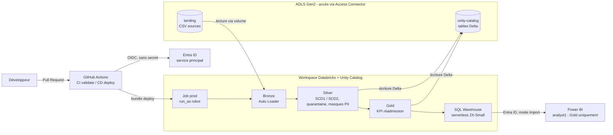

# Azure Databricks Healthcare Medallion

Plateforme de données sur **Azure Databricks** qui calcule le **taux de réadmission des patients à 30 jours**, par hôpital et par maladie.
Architecture **Medallion** (Bronze / Silver / Gold), gouvernance **Unity Catalog**, déploiement **CI/CD GitHub Actions en OIDC**, consommation **Power BI**.


---

## Le besoin métier

Une réadmission moins de 30 jours après une sortie signale souvent un soin incomplet et coûte cher.
La plateforme répond à trois questions :

- Quel hôpital a le plus fort taux de réadmission à 30 jours ?
- Pour quelle maladie ?
- Quel est le coût et la durée moyenne des séjours concernés ?

**Sources** : 4 fichiers CSV (`patients`, `hospitals`, `diagnosis`, `visits`) déposés dans ADLS Gen2.

---

## Architecture



**Principe clé** : toute lecture et toute écriture passent par **Unity Catalog**. Aucun utilisateur n'a de droit direct sur le stockage.

---

## Stack technique

| Domaine | Technologies |
| --- | --- |
| Cloud | Azure (ADLS Gen2, Entra ID, Access Connector, Cost Management) |
| Traitement | Azure Databricks, PySpark, Spark SQL, Delta Lake, Auto Loader |
| Gouvernance | Unity Catalog (external locations, volumes, GRANT par groupe, column masks) |
| Orchestration | Databricks Jobs (serverless), Databricks Asset Bundles |
| CI/CD | GitHub Actions, OIDC (workload identity federation), service principal |
| BI | Power BI Desktop, SQL Warehouse serverless |

---

## Pipeline Medallion

### Bronze : copier sans transformer
- Notebook générique d'ingestion des 4 sources avec **Auto Loader**.
- Schéma explicite en STRING + colonne `_rescued_data` (aucune donnée perdue).
- Traçabilité : `_source_file`, `_file_modified_at`, `_ingested_at`.
- `trigger(availableNow=True)` : traite les nouveaux fichiers puis s'arrête.

### Silver : nettoyer et modéliser (modèle en étoile)

| Table | Stratégie |
| --- | --- |
| `dim_diagnosis` | SCD1 |
| `dim_hospital` | SCD2 (historique du nom, de la ville, du nombre de lits) |
| `dim_patient` | Hybride : SCD2 sur la ville, SCD1 sur l'identité, **colonnes PII masquées** |
| `fact_visit` | Clés et mesures uniquement, **aucune PII** |

- `foreachBatch` + `MERGE`, dédoublonnage par `row_number()`.
- Lignes invalides envoyées en **quarantaine** avec la raison du rejet.
- Pipeline **idempotent** : relancer un notebook ne crée jamais de doublons.

### Gold : répondre au métier
- `visit_readmission` : délai avant la prochaine admission (`LEAD`), indicateur `is_readmitted_30d`, jointure **point-in-time** sur l'historique SCD2.
- `hospital_disease_kpi` : visites, réadmissions, taux, coût total et moyen, durée moyenne de séjour.

> Le taux agrégé se calcule toujours comme **somme des réadmissions / somme des visites**, jamais comme une moyenne de taux.

---

## Gouvernance et sécurité

| Groupe | Droits |
| --- | --- |
| `data-engineers` | Lecture et écriture sur le catalogue `hospital`, propriétaire des tables et des fonctions |
| `analysts` | Lecture de `hospital.gold` uniquement |

- **Column masks** sur les données personnelles (`mask_pii_string`, `mask_pii_date`).
- **Identités techniques** : Access Connector (stockage) et service principal (déploiement et exécution du job prod).
- **Aucun secret** : authentification OIDC pour la CI/CD, Entra ID pour Power BI.
- **Preuve** : connecté en tant qu'analyste, Power BI ne voit que les tables Gold.

---

## DataOps : du commit à la production

```
Branche → Pull Request → CI (bundle validate) → Revue → Merge → CD (bundle deploy -t prod) → Job prod
```

| | Dev | Prod |
| --- | --- | --- |
| Déployé par | Le développeur | GitHub Actions (CD) |
| Exécuté en tant que | Le développeur | Service principal (`run_as`) |
| Code | Git folder, en direct | Copie figée de `main` |

---

## Structure du repo

```
azure-databricks-healthcare-medallion/
├── .github/workflows/
│   ├── ci.yml                  # Validation du bundle sur chaque Pull Request
│   └── cd.yml                  # Déploiement en prod à chaque merge dans main
├── databricks.yml              # Configuration du bundle (cibles dev et prod)
├── resources/
│   └── hospital_job.yml        # Job : Bronze → 4 Silver en parallèle → Gold
├── src/
│   ├── bronze/01_bronze_ingestion
│   ├── silver/01_diagnosis_silver … 04_visits_silver
│   └── gold/01_gold_hospital_kpi
└── README.md
```

---

## Déploiement

**Dev** (depuis le workspace ou en local) :
```bash
databricks bundle validate
databricks bundle deploy          # cible dev par défaut
```

**Prod** : automatique au merge dans `main` (workflow `cd.yml`).
Variables GitHub requises : `AZURE_CLIENT_ID`, `AZURE_TENANT_ID`, `DATABRICKS_HOST`, `NOTIFICATION_EMAIL`.

---

## FinOps

- Coût total du POC : **environ 75 $**, environ 0,07 $ par jour hors sessions (stockage).
- Incident de coût diagnostiqué et corrigé : assistant IA, notebooks restés attachés, warehouse surdimensionné.
- Choix assumés : serverless en mode standard, `availableNow`, warehouse 2X-Small avec arrêt après 5 min, Power BI en mode Import, budget avec alertes à 50 % et 80 %.

---

## Résultats

| Hôpital | Maladie | Taux de réadmission à 30 jours |
| --- | --- | --- |
| Manipal | Kidney Infection | 50 % |
| Kokilaben | Chest Pain | 50 % |
| Autres | — | 0 % |

---

## Limites et évolutions

- Un catalogue par environnement (`hospital_dev`, `hospital_prod`) et un workspace par environnement.
- Infrastructure en **Terraform** (stockage, workspace, Unity Catalog, groupes, droits).
- Réseau privé : private endpoints, accès public désactivé.
- Tests automatisés des règles Silver dans la CI.

---

## Auteur

**Azeddine Ezzaaraoui** — Senior Data Engineer / Tech Lead Data